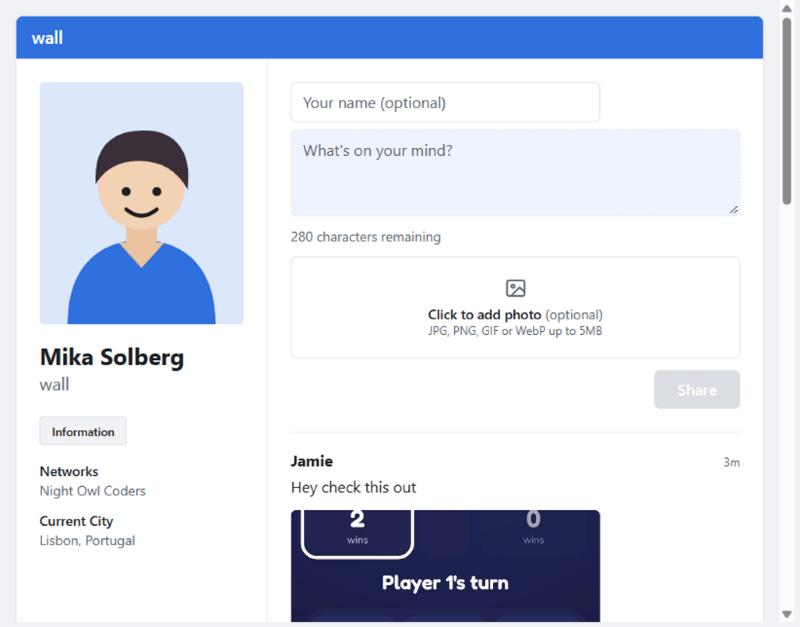
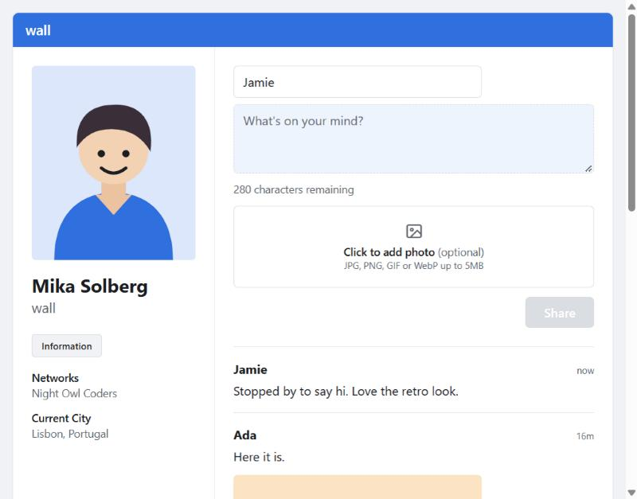
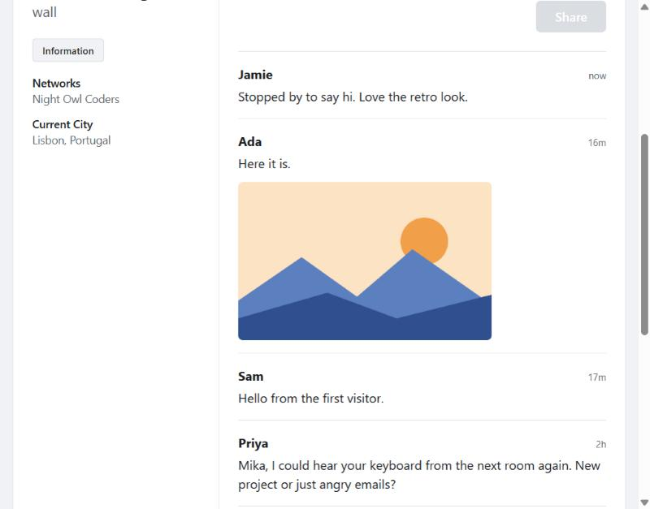
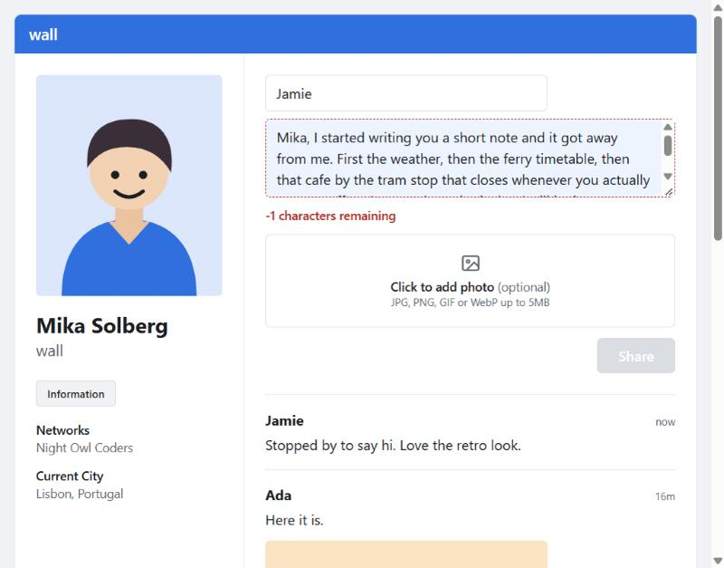

# Wall

**See it live:** https://wall-brown-one.vercel.app
A 2008-style profile wall built with React, Next.js and Supabase. Visitors type a message, press Share, and it appears at the top of a live feed.



## Features

- Write a message and share it; it is saved in a Supabase database
- A feed of the latest 50 posts, newest first, that survives a refresh
- Live updates: a post made in one browser appears in every other open one without reloading
- A 280-character limit with a live counter, enforced in the page and in the database
- Optional photo on a post, stored in Supabase Storage (JPG, PNG, GIF or WebP up to 5MB)
- No login: type a message and press Share. Visitors can add their name, remembered in their browser, or post as Guest
- New posts ease into the feed, with motion switched off for visitors who prefer reduced motion
- Loading, empty and error states, and a clear notice if the database is not connected
- Works by keyboard, labelled for screen readers, and laid out for phones

## Screenshots

All screenshots are in the [`screenshots`](screenshots) folder.

| File | What it shows |
|---|---|
| [`01-wall.jpg`](screenshots/01-wall.jpg) | The wall: profile on the left, composer and feed on the right |
| [`02-new-post.jpg`](screenshots/02-new-post.jpg) | A message just shared, at the top of the feed |
| [`03-photo-post.jpg`](screenshots/03-photo-post.jpg) | A post with a photo |
| [`04-character-limit.jpg`](screenshots/04-character-limit.jpg) | The counter past 280 characters, with Share disabled |
| [`05-phone.jpg`](screenshots/05-phone.jpg) | The phone layout |

| New post | Photo post | Character limit |
|---|---|---|
|  |  |  |

## Stack

Next.js (App Router), React 19, TypeScript and Tailwind CSS, with Supabase for the database, live updates and photo storage, deployed on Vercel. The only added runtime dependency is `@supabase/supabase-js`. Buttons and inputs are hand-written; there is no component library.

Built with [Claude Code](https://claude.com/claude-code) as a pair programmer.

## How the data is protected

There is no login, so the page talks to Supabase with its public key. What a visitor can do is decided by rules in the database, not by keeping that key secret:

| A visitor can | A visitor cannot |
|---|---|
| Read posts | Edit or delete any post |
| Add a post with a name, a message and an optional photo | Set a post's id or timestamp |
| Upload an image of up to 5MB | Upload other file types, or overwrite, list or delete files |

The name, message and photo limits are checked by the database as well as the page. All of this is in [`supabase/setup.sql`](supabase/setup.sql).

## Set it up yourself

1. Create a project at [supabase.com](https://supabase.com).
2. Open the SQL Editor, paste the contents of [`supabase/setup.sql`](supabase/setup.sql), and run it once. This creates the `posts` table, its access rules, the live-update setting, the `wall-photos` storage bucket and six starter posts.
3. Copy `.env.example` to `.env.local` and fill in your project's URL and publishable (anon) key. Both are on the project's home page under Copy, or in Project Settings → API.
4. Install and run:

```bash
npm install
npm run dev
```

Then open http://localhost:3000.

To deploy on Vercel, import the repository and add the same two values as environment variables before deploying.

Free Supabase projects pause after a period without activity; resume the project in the Supabase dashboard if the wall stops loading.

## Project structure

```
src/
  app/                 page shell, theme and favicon
  components/
    Wall.tsx           top bar and two-column layout
    ProfileSidebar.tsx the profile column
    WallFeed.tsx       the only stateful component: posts, loading, live updates
    Composer.tsx       name, message, photo and Share
    PhotoPicker.tsx    choosing and previewing a photo
    PostList.tsx       the feed and its loading, empty and error states
    PostItem.tsx       one post
  lib/
    validation.ts      name, message and photo rules
    time.ts            "now", "5m", "2h" time labels
    feed.ts            keeps the feed sorted, de-duplicated and capped
    posts.ts           every call to Supabase
    supabase.ts        creates the Supabase client
supabase/
  setup.sql            the database, in one script
screenshots/           screenshots of the app
```

`validation`, `time` and `feed` are plain functions covered by unit tests.

## Commands

| Command | What it does |
|---|---|
| `npm run dev` | Start the development server |
| `npm run build` | Build for production |
| `npm run start` | Serve the production build |
| `npm run test` | Run the unit tests |
| `npm run lint` | Lint the code |
| `npm run typecheck` | Check types |
